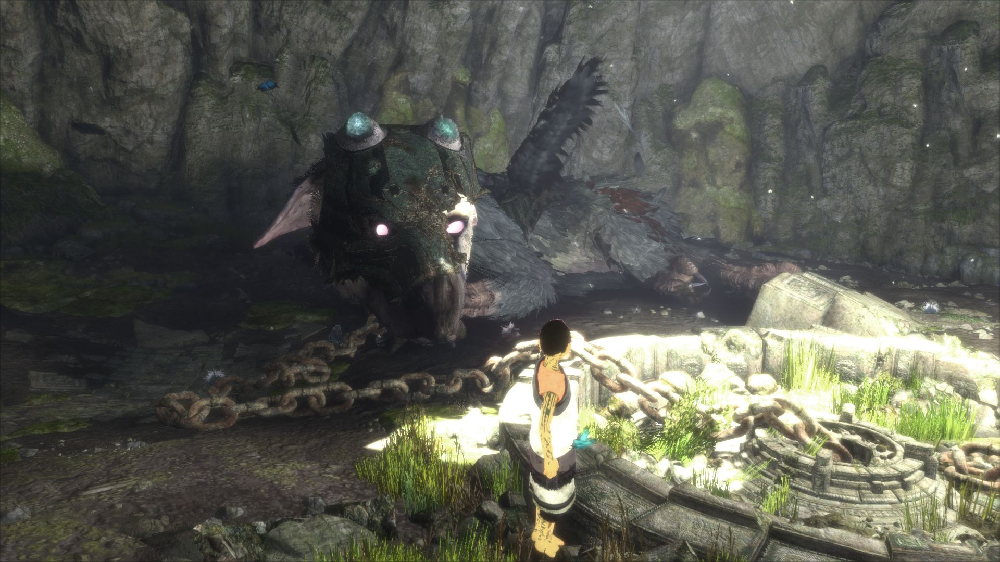
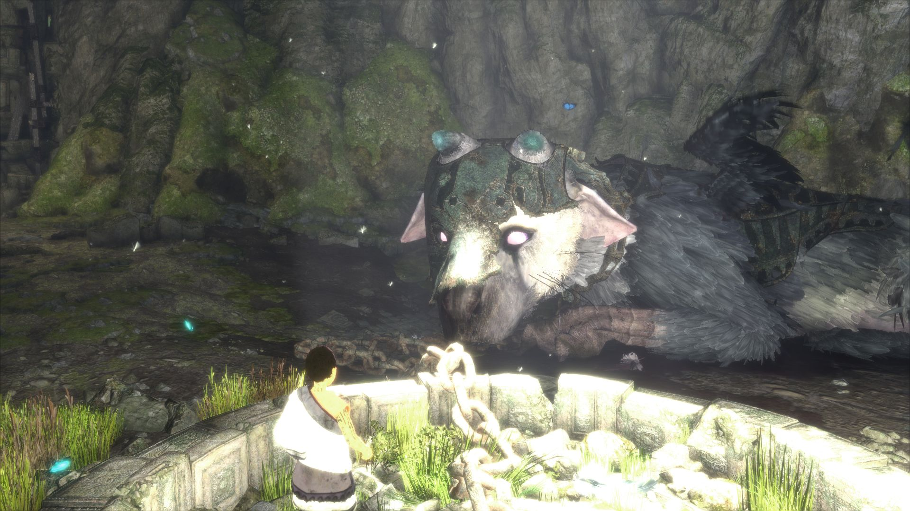
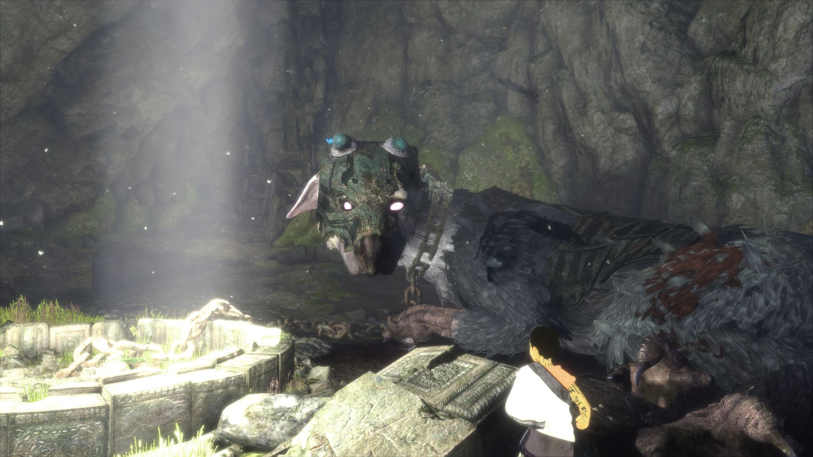
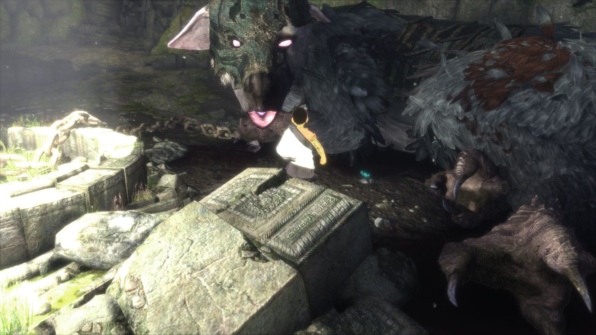
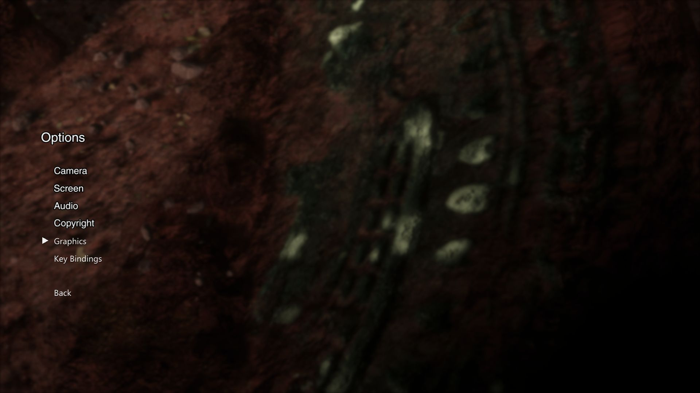
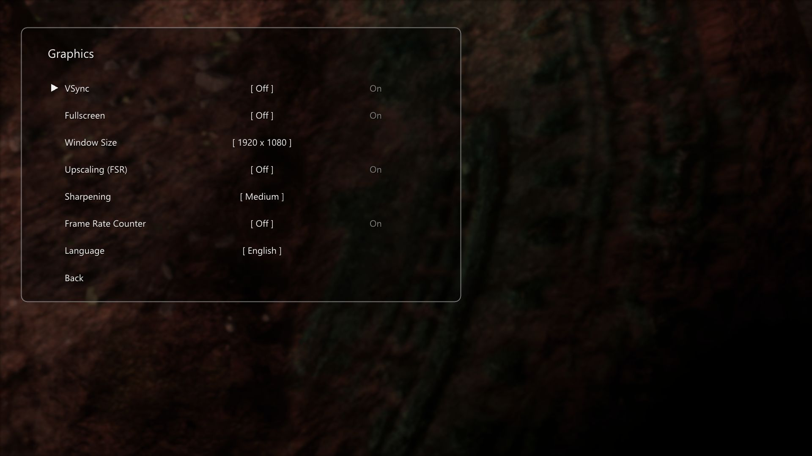
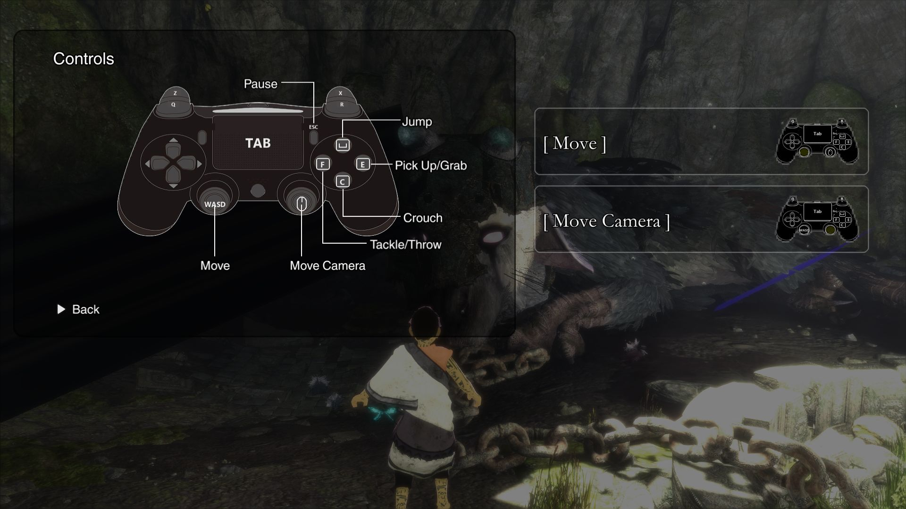

# The Last Guardian on PC (tlg-pc): unofficial build scripts, notes and how to play

This repository holds the wrapper around a game-specific build of the
[shadPS4](https://github.com/shadps4-emu/shadPS4) emulator that runs **The Last Guardian**
(PS4, CUSA03627, v1.03) on Windows: build and packaging scripts, the files that sit beside the
finished program, the tools that make the keyboard and Xbox button pictures, and the test
scripts. The emulator source with the changes for this game is in the `runtime` branch of this
repository (the `runtime` folder, a git submodule).

It is an unofficial, game-specific build derived from shadPS4. It is not affiliated with or
endorsed by Sony Interactive Entertainment, genDESIGN, SIE Japan Studio or the shadPS4 project.

## How this works

This is not a rewrite of the game. The game's own PS4 program, read from your copy and left
as it is on disk, runs inside a custom build of the shadPS4 emulator made for this game:

- **The runtime** is the source of shadPS4, GPL-2.0-or-later, with this project's commits on
  top. It shares its base with the [inFAMOUS Second Son build](https://github.com/SotC-project/i3-pc)
  (keyboard and mouse bindings, button icons that follow the device in use, upscaling and
  window settings). Nothing here is sent upstream.
- **The game is not included.** You need your own copy of the game, dumped from your own
  console; the program only reads it.

What the runtime adds for this game (serial CUSA03627 only):

- A fix for depth-only pipelines that crashed the game at boot.
- **PC settings inside the game's own Options screen**, from the title screen and from the
  pause menu: below the game's lines come **Graphics** and **Key Bindings**, drawn in the
  screen's style, then Back. The runtime recognises the game's menu by the textures it draws,
  keeps the cursor in step with the game's own, and hides the game's cursor and Back line while
  the PC lines are shown. There is no separate settings window.
- **Button pictures for keyboard and Xbox controllers**: the controller picture in the tutorial
  hints and the controller diagram on the pause menu's Controls page are replaced by a keyboard
  or an Xbox version while that device is in use, keeping every button where the game's glow
  and leader lines expect it.

## Screenshots

1080p, captured from this build on 2026-10-15, keyboard and mouse in use. The game runs at its
own 30 frames per second limit.

<table>
<tr>
<td width="50%"> The first cave</td>
<td width="50%"> Trico, chained</td>
</tr>
<tr>
<td width="50%"> Light through the cave roof</td>
<td width="50%"> Close to Trico</td>
</tr>
<tr>
<td width="50%"> The game's own Options screen, with the PC lines Graphics and Key Bindings</td>
<td width="50%"> Graphics</td>
</tr>
<tr>
<td width="50%"> Key Bindings, with the game's names for the actions</td>
<td width="50%"> The pause menu's Controls guide and the tutorial hints, keyboard version</td>
</tr>
</table>

## Status

Work in progress. What has been run and checked, headless with scripted input, many times
without a crash:

- boot, logos, title screen, New Game and Continue, the opening sequence;
- gameplay in the first cave at a steady 30 frames per second (the game's own limit),
  including 21-minute sessions of continuous scripted play without a crash;
- keyboard and mouse moving the boy and the camera; an Xbox controller in the menus and moving
  the boy;
- the Options screen from the title and from the pause menu, with the Graphics and Key Bindings
  pages, and the game's own Controls guide with the keyboard and Xbox diagrams.

Later parts of the game have not been played through with this build yet.

## How to play

### 1. What you need

- Windows 10 or 11, 64-bit, and a graphics card with Vulkan support.
- Your own dump of The Last Guardian, CUSA03627, updated to 01.03 (the folder that holds
  `eboot.bin` and the `trico_*.psarc` archives).

### 2. Get the program

Build it (below), then run `bash tools/make_dist.sh`: it makes the `dist` folder with
`The Last Guardian.exe`, a clean `user` profile, `Play.bat`, `Install.bat` (Desktop and Start
menu shortcuts) and the player's guide `README.txt`.

### 3. Tell the program where the game is

`dist\game_path.txt` holds the path of the game's `eboot.bin`, one line. Started without
arguments, the program reads it and boots straight into the game; settings and saves stay in
`dist\user`.

After updating the program, delete `dist\user\cache`: compiled shaders are cached there by the
game's shader, so an older build's versions would otherwise be used.

### 4. Controls

Keyboard and mouse, by default (the actions are the game's own names):

| Keys | Action |
|---|---|
| W A S D, mouse | move, camera |
| Space | jump |
| C | crouch |
| E, right mouse | pick up / grab, pet Trico |
| F, left mouse | tackle / throw |
| R | call Trico |
| Left Ctrl | contemplate (hold) |
| Left arrow, 3 | wield or put away the mirror |
| Esc | pause |
| Enter, Backspace | select, back (menus) |

Every action can be changed in Options > Key Bindings, or in
`user\input_config\CUSA03627.ini` (F8 reloads it while the game runs). Controllers (Xbox,
DualShock, DualSense and others through SDL) use the console's layout.

### 5. Graphics settings

Options > Graphics: VSync, fullscreen, window size, FSR upscaling, sharpening, frame rate
counter and the game's language (English, French, Spanish, Portuguese: the languages of the
CUSA03627 release).

### Reporting a problem

Open an issue with what you did, what you saw, and `dist\user\log\shad_log.txt`.

## Building

1. Clone with the runtime: `git clone --recursive https://github.com/SotC-project/tlg-pc.git`
2. Visual Studio 2022 (C++ workload), CMake and a clang toolchain; `build.bat` names the paths
   used here, adjust them to yours.
3. `build.bat` builds `runtime\Build\x64-Clang-RelWithDebInfo\shadps4.exe`; copy it to
   `bin\tlg.exe`.
4. The button pictures are made from the game's own textures, so they are not in this
   repository: run the game once with `SOTC_TEXDUMP=1` and
   `SOTC_TEXDUMP_HASHES=4641711da2e67237,9e20a9967275538f` while a tutorial hint and the pause
   menu's Controls page are on screen, decode the two dumps to PNG beside `tools/make_icons.py`
   (texture2ddecoder, BC7), then run `python tools/make_icons.py <profile>\user`.

## What is not here

No game files and no keys. Apart from the screenshots in `docs/img`, no game art: decoded
textures, archive listings and the generated button pictures stay on your machine.

## Layout

| Path | What |
|---|---|
| `runtime/` | the emulator source (branch `runtime`), as a submodule |
| `build.bat` | builds the runtime |
| `test.sh`, `disttest.sh` | headless test runs with scripted input and screenshots |
| `tools/patch_ui.py` | the hooks of the Options rows in the renderer and input code |
| `tools/ui_hashes.py` | makes `runtime/src/core/tlg/ui_textures.h` from the game's archives |
| `tools/psarc.py` | reads the game's `.psarc` archives |
| `tools/bc7enc.py`, `tools/make_icons.py` | draw and encode the keyboard and Xbox pictures |
| `tools/make_dist.sh`, `tools/dist*/` | the finished program's folder and its default profile |

## Licence

GPL-2.0, as the shadPS4 code it builds on; see `LICENSE`.
